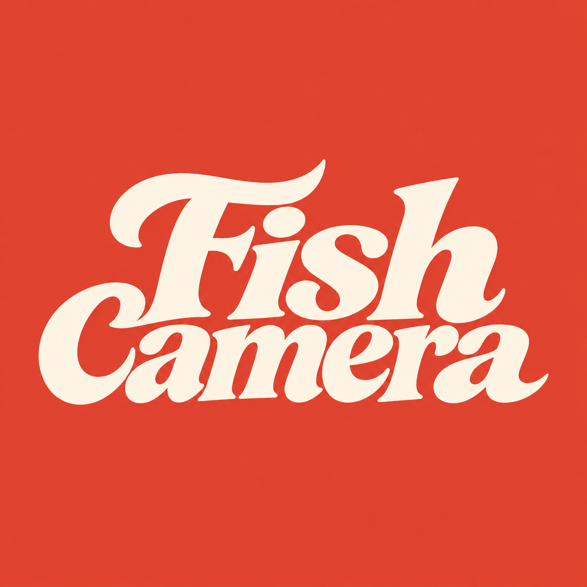
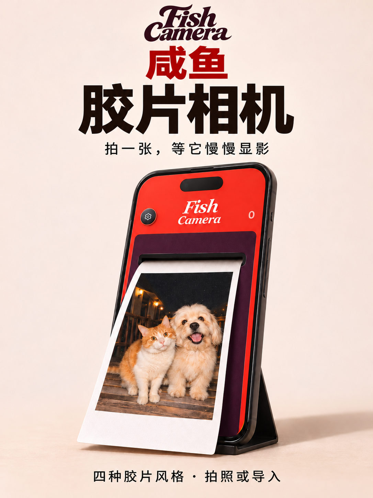
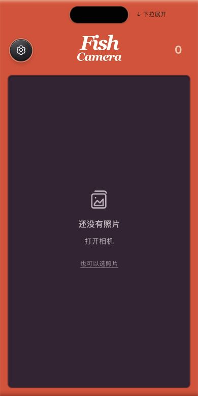
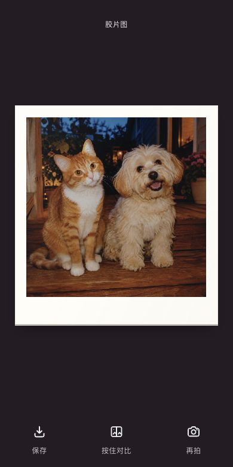

<div align="center">
  
  <h1>咸鱼胶片相机 · Fish Camera</h1>
  <p><strong>拍一张，等它慢慢显影。</strong></p>
  <p>一款面向手机和小红书小工具的胶片风格相机。拍照或导入照片，看相纸吐出来，再慢慢显影。</p>
</div>

<table>
  <tr>
    <td align="center" valign="middle"></td>
    <td align="center" valign="middle"></td>
    <td align="center" valign="middle"></td>
  </tr>
  <tr>
    <td align="center">应用封面 · 出纸效果示意</td>
    <td align="center">实际界面 · 首页</td>
    <td align="center">实际界面 · 显影成片</td>
  </tr>
</table>

成片截图使用生成的猫狗样张，由本地运行的 Fish Camera 显影。

## 从按下快门到拿到相纸

1. **打开相机。** 点击顶部字标展开相机，授权后即可取景。首页的「也可以选照片」可直接导入图片。
2. **选胶片和画幅。** 在相机里切换滤镜，双指捏合或拉开取景器，在正方形和 3:4 竖幅之间切换。拍摄或导入时会使用当前选择。
3. **拍摄或导入。** 按下快门，或点击「选照片」导入图片。照片从相机滑出，显影画面逐渐清晰。等候时可以轻轻滑动相纸。
4. **对比与保存。** 显影完成后按住「按住对比」查看原图。小红书客户端支持保存能力并已授予相册权限时，可保存带相纸边框的 PNG。

| 胶片风格 | 相机里的标识 |
| --- | --- |
| 柔和人像 | PORTRA 400 |
| 暖调日常 | GOLD 200 |
| 清透日光 | PRO 400H |
| 经典黑白 | HP5 PLUS |

照片在设备上处理，导入时保留原文件。本次相册用于浏览当前会话的照片，喜欢的成片记得保存到系统相册。

## 本地运行

项目由 HTML、CSS 和 JavaScript 组成，无需安装前端依赖或构建。用 Python 3 启动本地服务。

```sh
git clone https://github.com/davidai1024/fish-camera.git
cd fish-camera
python3 -m http.server 8000 --bind 127.0.0.1
```

在支持 WebGL 的浏览器中打开 [http://localhost:8000](http://localhost:8000)。先用「也可以选照片」体验显影，再按需授权使用摄像头。普通浏览器可以预览、显影和对比，相册保存通过小红书客户端接口提供。

当前代码来自 `3.2.6` 移动端验证版。小红书内的保存、振动和陀螺仪交互取决于客户端能力与权限，上线前请在目标设备上验证。

## 源码导览

| 文件 | 负责的工作 |
| --- | --- |
| `index.html`、`app.js`、`style.css` | 相机界面、交互和本次相册 |
| `camera.js`、`gestures.js`、`hold-compare.js` | 拍摄、手势和按住对比 |
| `pipeline.js`、`mobile-render.js`、`mobile-*.js` | 胶片与相纸配方、WebGL 显影和本地渲染 |
| `paper-print.js`、`paper-motion.js`、`development.js` | 出纸、相纸运动和显影进度 |
| `platform.js`、`photo-store.js` | 小红书客户端适配、本机缓存与 PNG 保存 |

## 许可与致谢

- **应用代码**采用 GPL-3.0-or-later。Minseo 修改并移植了 Hanze Qiu 的 SpektraLab。出纸和滑动相纸的声音由 Web Audio 合成。[SpektraLab](https://github.com/JamesQiu2005/SpektraLab) · [许可证](LICENSE) · [公开版变更](CHANGELOG.txt)
- **胶片与相纸数据**衍生自 Andrea Volpato 的 spektrafilm，经 Minseo 修改并转换为移动端使用的查找表和配方数据，采用 CC BY-SA 4.0。[spektrafilm](https://github.com/andreavolpato/spektrafilm) · [数据许可与署名](licenses/SPEKTRAFILM-CC-BY-SA-4.0.json)
- **界面交互**参考 pico cam。Fish Camera 是独立项目。
